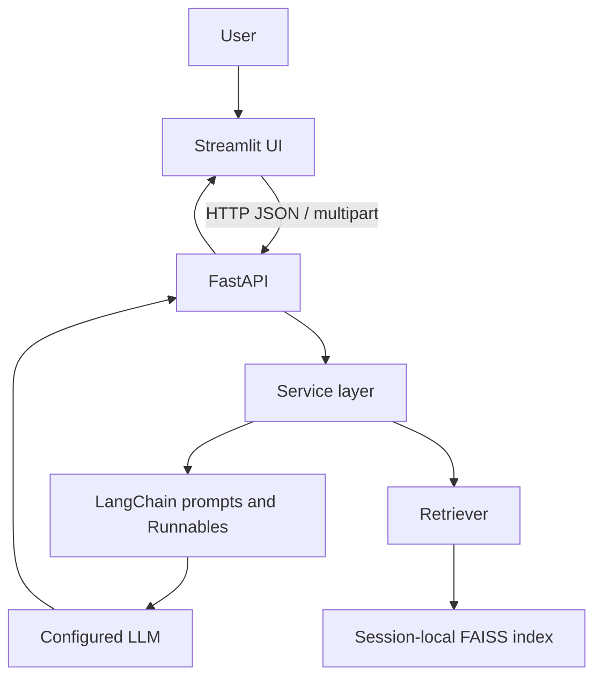
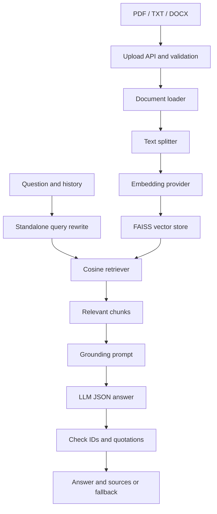

# AI-Powered Chatbot
## IntelliChat – AI-Powered Knowledge Assistant

A full-stack AI chatbot developed using FastAPI, Streamlit, LangChain, LLMs, and Retrieval-Augmented Generation.

**Official academic title:** AI-Powered Chatbot  
**Project implementation:** IntelliChat – AI-Powered Knowledge Assistant

## Project Overview
IntelliChat combines general conversation with document-grounded question answering. A Streamlit client calls a real FastAPI backend; reusable services own ingestion, memory, provider calls, and FAISS retrieval. The project is ready for local provider configuration and a capstone demonstration.

## Problem Statement
Information is scattered across long documents. Keyword searches do not reliably interpret natural-language follow-ups, while a general LLM does not automatically know the user's files and can invent answers.

## Objectives
- Offer general chat and document chat through one interface.
- Retrieve relevant PDF, TXT, and DOCX passages with real metadata.
- Resolve contextual follow-ups while keeping history separate from evidence.
- Demonstrate a testable client-server architecture and transparent evaluation.
- Centralize configuration, secrets, errors, and document handling.

## IntelliChat Overview
The product is **IntelliChat – AI-Powered Knowledge Assistant**; the submission title remains **AI-Powered Chatbot**. This is a local capstone implementation with production-style separation of concerns, not a hardened multi-tenant service.

## Key Features
General chat without documents; multiple document uploads; processing status; incremental embedding; FAISS cosine retrieval; contextual query rewriting; evidence quotation and source-ID checks; safe fallback; bounded session memory; Top-K/temperature controls; source expanders; latency display; Markdown export; New Chat and clear controls; health checks; Swagger/ReDoc; OpenAI and Ollama adapters; credential-free tests.

## Technology Stack
| Layer | Implementation |
|---|---|
| Runtime | Python 3.12, verified locally |
| Frontend / HTTP | Streamlit / HTTPX |
| Backend | FastAPI / Uvicorn |
| Validation / configuration | Pydantic 2, pydantic-settings, python-dotenv |
| AI orchestration | LangChain Core prompts, messages, parsers, Runnables |
| Providers | langchain-openai, langchain-ollama |
| Documents | pypdf, python-docx, langchain-text-splitters |
| Vector search | faiss-cpu / NumPy |
| Verification | pytest, FastAPI TestClient, Streamlit AppTest, Ruff |

Only the required LangChain component packages are used; the umbrella package and deprecated legacy chains are unnecessary. Direct dependency ranges are in requirements.txt; the tested full environment is in requirements-lock.txt.

## System Architecture


## Why FastAPI?
FastAPI validates contracts through Pydantic, exposes OpenAPI documentation, and supports additional clients using the same services. Blocking SDK and parser calls run in worker threads through synchronous route functions.

## Why LangChain?
LangChain supplies common model, embedding, document, prompt, message, and Runnable interfaces. IntelliChat composes `prompt | model | StrOutputParser()` instead of older monolithic conversation chains. Provider-specific code stays in factories.

## What is RAG?
Retrieval-Augmented Generation searches external knowledge before generating an answer. Relevant text enters the prompt at inference time; model weights are not trained or fine-tuned.

## How RAG Works in IntelliChat

1. Upload validates and extracts text without calling an embedding API.
2. Process splits pending files into 1,000-character chunks with 150-character overlap.
3. New chunk vectors are staged in FAISS and committed only after success.
4. Follow-up questions are rewritten using mode-specific history.
5. The query is embedded once; existing document vectors are reused.
6. Up to four chunks by default must pass a configurable cosine threshold.
7. The LLM returns an answer with evidence quotations linked to chunk IDs.
8. IDs and quotations are checked against the actual retrieved chunks.

Invalid or absent evidence produces: “I could not find enough information in the uploaded documents to answer this question.”

Valid quotations establish provenance, not semantic entailment of every claim. Human evaluation is still required. The similarity threshold is a starting value, not a calibrated accuracy guarantee.

## Backend Architecture
- api/: typed routes, bounded file reads, and service delegation.
- core/: settings, logging, safe errors, bounded session registry.
- schemas/: request/response and internal grounded-answer contracts.
- services/: chat, document lifecycle, RAG orchestration, evaluation.
- ai/: provider factories, parsers, splitter, prompts, FAISS, retrieval, pipelines.
- main.py: app factory, lifespan, CORS, errors, and dependency wiring.

FAISS directly pairs LangChain Documents/Embeddings with IndexFlatIP. Normalized inner product equals cosine similarity. FAISS was selected for local setup and transparent exact search. No unsafe pickle loading is used.

Each session owns documents, an index, and separate general/RAG histories. Ten turns per mode and one hour of idle lifetime are defaults. Expiry is checked on subsequent access. Concurrent same-session operations receive HTTP 409. Use **one Uvicorn worker**; processes do not share in-memory state.

## Frontend Architecture
app.py renders UI and manages display state. api_client.py owns all HTTP calls. ui_helpers.py renders sources and exports Markdown. No model or embedding logic runs in the UI.

**New Chat** clears old data and creates a UUID with an empty knowledge base. **Clear Conversation** keeps documents. **Clear Knowledge Base** removes documents, vectors, and RAG memory, retaining general chat. A browser reload may create a new frontend session; export before leaving.

## REST API Endpoints
| Method | Path | Input / result |
|---|---|---|
| GET | / | Application liveness |
| GET | /health | Application/version; no remote provider health call |
| GET | /api/config | Safe model/UI settings, never keys |
| POST | /api/chat | ChatRequest JSON → answer, sources, latency |
| POST | /api/chat/clear | JSON session_id → clear histories |
| POST | /api/documents/upload | Multipart session_id + files → validated files, HTTP 201 |
| POST | /api/documents/process | JSON session_id → embed pending documents |
| GET | /api/documents | Query session_id → document status |
| DELETE | /api/documents | Query session_id → clear KB and RAG memory |

```json
{
  "message": "What is the remote work policy?",
  "mode": "rag",
  "session_id": "example-session",
  "top_k": 4,
  "temperature": 0.2
}
```
Response fields: answer, session_id, mode, sources, processing_time_ms.
Sources contain file_name, page (null for TXT/DOCX), chunk_id, excerpt, similarity.
Use the same session ID for upload, process, and chat.

Errors return `{"code": "...", "message": "..."}`: 409 missing/busy state or filename conflict; 413 limits; 415 unsupported format; 422 invalid input/file; 429 rate limit; 502 provider/output failure; 503 unavailable/configuration; 504 timeout.

## Project Structure
```text
AI-powered Chatbot/
├── backend/
│   ├── main.py
│   ├── api/          routes_chat.py, routes_documents.py, routes_health.py
│   ├── core/         config.py, exceptions.py, logging_config.py, state.py
│   ├── schemas/      chat.py, documents.py, common.py
│   ├── services/     chat_service.py, document_service.py, rag_service.py,
│   │                 evaluation_service.py
│   └── ai/           llm.py, embeddings.py, vector_store.py, retriever.py,
│                     text_splitter.py, document_loader.py, prompts.py, rag_chain.py
├── frontend/         app.py, api_client.py, ui_helpers.py
├── tests/            API, parser, splitter, vector, RAG, memory, UI, provider tests
├── sample_data/      company_policy.txt, evaluation_dataset.json
├── scripts/          verify_project.py, smoke_servers.py
├── .streamlit/config.toml
├── evaluation.py
├── requirements.txt
├── requirements-lock.txt
├── pyproject.toml
├── .env.example
├── .gitignore
└── README.md
```
Every Python package has __init__.py. See docs/PROJECT_TREE.txt for the full delivered tree.

## Installation
Use **Python 3.12**, with a terminal in the project root.

Windows PowerShell:
```powershell
py -3.12 -m venv .venv
.venv\Scripts\python.exe -m pip install -r requirements-lock.txt
Copy-Item .env.example .env
```
macOS/Linux:
```bash
python3.12 -m venv .venv
.venv/bin/python -m pip install -r requirements.txt
cp .env.example .env
```

## Configuration
Edit .env locally and restart both services after changes. Never commit .env.
```dotenv
LLM_PROVIDER=openai
LLM_API_KEY=your-key-here
LLM_MODEL=gpt-4.1-mini
EMBEDDING_PROVIDER=openai
EMBEDDING_MODEL=text-embedding-3-small
```
EMBEDDING_API_KEY falls back to LLM_API_KEY when both providers use OpenAI. No real key is bundled. Model access and billing depend on your provider account.

For local Ollama, install Ollama separately, pull models, and ensure its server is running:
```bash
ollama pull llama3.2
ollama pull nomic-embed-text
ollama serve
```
Do not start a second server if Ollama is already running. Configure:
```dotenv
LLM_PROVIDER=ollama
LLM_MODEL=llama3.2
EMBEDDING_PROVIDER=ollama
EMBEDDING_MODEL=nomic-embed-text
OLLAMA_BASE_URL=http://127.0.0.1:11434
```
Local models must follow the JSON evidence contract; malformed output produces a retry error.
Changing the embedding model requires a fresh index.

| Variables | Defaults / purpose |
|---|---|
| APP_NAME, APP_VERSION | IntelliChat, 1.0.0 |
| LLM_PROVIDER, LLM_MODEL, LLM_API_KEY | Chat provider/model/secret |
| EMBEDDING_PROVIDER, EMBEDDING_MODEL, EMBEDDING_API_KEY | Embedding provider/model/secret |
| OLLAMA_BASE_URL | http://127.0.0.1:11434 |
| LLM_SUPPORTS_TEMPERATURE | true; false for models that reject temperature |
| PROVIDER_TIMEOUT_SECONDS, MAX_OUTPUT_TOKENS | 60 per call; 1200 output tokens |
| CHUNK_SIZE, CHUNK_OVERLAP | 1000 / 150 characters |
| TOP_K, MIN_SIMILARITY | 4 / cosine 0.2 |
| MAX_UPLOAD_MB, MAX_FILES_PER_SESSION | 10 MB / 20 |
| MAX_EXTRACTED_CHARS | 500000 per document |
| MAX_HISTORY_TURNS, MAX_SESSIONS | 10 per mode / 32 sessions |
| SESSION_TTL_SECONDS | 3600 |
| FASTAPI_HOST, FASTAPI_PORT | 127.0.0.1 / 8000 |
| BACKEND_URL | http://127.0.0.1:8000 |
| CORS_ORIGINS | JSON array of the two local Streamlit origins |
| LOG_LEVEL | INFO |

FASTAPI_HOST/PORT are read by `python -m backend.main`; direct Uvicorn CLI arguments control its host/port.
The frontend widget also has a 10 MB cap in .streamlit/config.toml; update both if increasing the limit.

## Running FastAPI
**Terminal 1, project root:**
```powershell
.venv\Scripts\python.exe -m uvicorn backend.main:app --reload --host 127.0.0.1 --port 8000
```
Activated environment: `uvicorn backend.main:app --reload`.
Include `:app`; `uvicorn backend.main` alone is not a valid import string.

## Running Streamlit
**Terminal 2, same project root:**
```powershell
.venv\Scripts\python.exe -m streamlit run frontend/app.py
```
Activated environment: `streamlit run frontend/app.py`.
Open [IntelliChat](http://127.0.0.1:8501). **Both services must run.**
When FastAPI is offline: “Backend service is currently unavailable. Please start the FastAPI server.”

## Using IntelliChat
Configure a provider → start both services → ask a general question → upload the sample policy → process documents → select Document / RAG Chat → ask questions → inspect Sources → ask follow-ups → export or clear.

## API Documentation
[Swagger UI](http://127.0.0.1:8000/docs), [ReDoc](http://127.0.0.1:8000/redoc),
[OpenAPI JSON](http://127.0.0.1:8000/openapi.json), [Health](http://127.0.0.1:8000/health).
An evaluator can upload/process/chat directly in Swagger with one session ID.

## Sample Questions
- How many annual leave days do employees receive?
- What is the remote work policy?
- How quickly must expenses be submitted?
- What are password requirements?
- Can employees work from another country?
- What does NovaTech say about training?
- Who is the CEO? → When did she join?
- What is NovaTech's revenue forecast for 2030? (expect insufficient-evidence fallback)

## Testing
Use an activated environment or replace python with .venv\Scripts\python.exe:
```bash
python -m pytest -q
python -m ruff check backend frontend tests scripts evaluation.py
python -m ruff format --check backend frontend tests scripts evaluation.py
python scripts/verify_project.py
python scripts/smoke_servers.py
```
Tests use fake models and deterministic topic embeddings **only in tests**. Real parsers, FAISS, routes, services, HTTP adapters, and Streamlit AppTest execute. No paid calls are required.
See docs/VERIFICATION.md for actual executed checks.

## Evaluation
sample_data/evaluation_dataset.json contains six labeled policy questions.
After provider configuration:
```bash
python evaluation.py --output evaluation-results.json
```
This invokes real providers and may incur costs. It builds a separate in-process sample index and calculates:
- retrieval_source_hit_at_k: presence of the expected file among retrieved chunks.
- retrieval_source_precision_at_k: fraction of retrieved chunks from that file.
- answer_token_f1: lexical overlap with the expected answer, not semantic correctness.
- evidence_token_coverage: unique answer words present in cited quotations, a weak grounding proxy.
- processing_time_ms: actual chat latency.
- human_correctness/human_groundedness: null until reviewed.

Retrieval metrics independently repeat search after each answer, adding one query embedding outside chat latency.
Single-file source scores are weak; add multiple files and chunk-level labels before drawing conclusions.
No real-provider evaluation scores are bundled or fabricated.

## Security
Keys stay in environment configuration and never appear in /api/config. .env, logs, runtimes, and evaluation output are ignored by Git.
Files are sanitized, validated, parsed in memory, and never executed. PDF text and DOCX expansion are bounded.
Logs contain events/counts rather than message/document bodies. Prompts treat retrieved content as untrusted.
CORS allows only http://localhost:8501 and http://127.0.0.1:8501; Streamlit itself calls the backend server-to-server.


## Limitations
In-memory state expires and disappears on restart; one worker is required.
No OCR, durable storage, authentication, streaming, or semantic entailment verifier is included.
DOCX/TXT have no reliable pages. Complex PDF reading order and DOCX headers/text boxes may be missed.
Long batches can exceed the frontend's 300-second timeout; refresh status before retrying processing.
Prompt instructions cannot eliminate injection or hallucination. CPU exact search targets small collections.
Provider credentials, model availability, live answer quality, and paid evaluation remain user-configured.

## Future Enhancements
Redis sessions, PostgreSQL history/auditing, durable vector storage, authenticated workspaces, OCR, hybrid retrieval/reranking, streaming, semantic evaluation, Docker, and monitored cloud deployment.

## Conclusion
IntelliChat demonstrates a complete route from uploaded documents to contextual retrieval and inspectable answers, with a clear REST boundary and honest evaluation limits.
